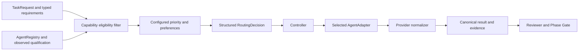
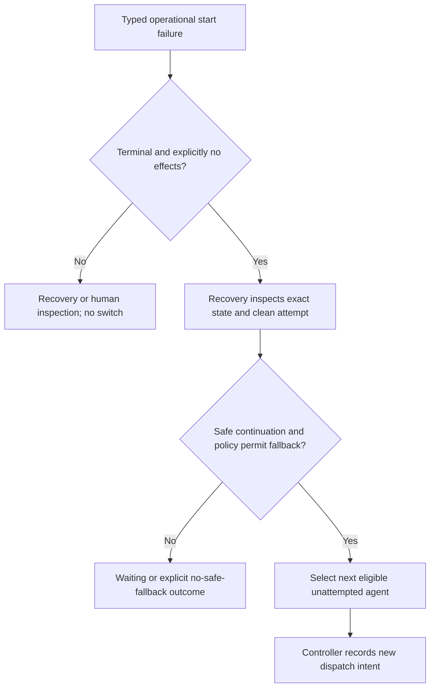

# Phase 16 — Agent Router + Fallback

## Responsibility and authority

AgentRouter selects worker assignments from the existing AgentRegistry. It executes
no adapters, commands, provider probes, Git operations, approvals or review. It uses
explicit typed requirements and supplied qualification observations, never prompt
prose, LLM judgments, price, inferred quality or learned performance. Controller
owns execution and durable audit; Recovery owns safe continuation inspection.

## Capability truth

Adapter existence is not eligibility. A required feature must have static adapter
support **and** externally observed AVAILABLE qualification. Runtime readiness must
also be AVAILABLE. BLOCKED, UNVERIFIED, UNAVAILABLE and missing observations reject.
Qualification is supplied trusted application/runtime data; Router does not certify
it or promote a provider. `observation_id` identifies its source/version.

Required and preferred features are distinct. Supported AVAILABLE preferred features
add score after configured priority; absence does not exclude. Custom safety features
(sandbox, network_disabled) need explicit supported extensions and corresponding
proof. `filesystem_write` needs filesystem support plus separate write qualification.
A missing safety extension is never inferred from a provider name or generic support.

| Current provider | Implementation | Production coding/tool qualification |
|---|---|---|
| Codex | PASS | AVAILABLE; previously real/live validated |
| Claude | PASS | NOT READY / BLOCKED; live UNVERIFIED |
| Gemini | PASS | NOT READY / BLOCKED; live UNVERIFIED |

All real provider approval_events remain FALSE. A task requiring verified interactive
approval may have no eligible provider. Approval Router alone does not supply a missing
adapter bridge. Neither Claude nor Gemini can be selected for blocked production tools.
Synthetic AVAILABLE fixtures demonstrate extensibility, not provider promotion.

## Policy and stable selection

`RoutingPolicy.priorities` is an explicit agent allowlist with integer priorities;
unconfigured and excluded agents are structurally rejected. Eligible ordering is
priority descending, supported AVAILABLE preferred count descending, agent_id lexical.
The decision contains all eligible/rejected candidates, their detached snapshots,
structured reasons, policy ID/digest, selected ID and bounded candidate fallback chain.
No clock, randomness or registry insertion order influences selection.

POLICY mode selects the highest eligible candidate. EXPLICIT mode requires the
request's exact agent ID and allow_explicit=True. An explicitly supplied ID is validated
even in POLICY mode; it is not silently ignored. Explicit assignment cannot bypass
qualification, runtime, exclusions or static capabilities.

Build `RoutingRequest.from_task(task, run_id, requirements, explicit_agent_id)` from a
revalidated canonical TaskRequest. The persistent request retains its complete digest
and project/run/phase/attempt/task/type identity, not prompt text or provider payloads.
Decision snapshots are detached from mutable caller collections. Revalidation checks
current Registry support, qualification, requirements and policy before dispatch;
changes fail closed instead of replaying stale authority. Re-route requires a new,
explicit cycle after inspection; persisted authority is never silently rewritten.

## Controller integration

Optional constructor parameters: worker_router, routing_policy, routing_requirements
and worker_bindings. The Router must use the Controller's same Registry. Each binding
contains a provider identity and provider-normalizer interface; no provider classes or
name branches enter core selection. Allowed tool names become additional required
capabilities; routing cannot grant tools absent from ControllerPolicy.

Existing explicit non-routed Controller mode stays compatible with earlier callers;
those callers retain their prior responsibility for provider qualification. Enable
routed mode for enforced qualification-based assignment. No CLI/config parser or
parallel provider registry was added; configuration is typed library injection.

Controller dispatches the selected adapter and applies its configured normalizer,
then retains the unchanged Evidence -> Reviewer -> Gate -> Version/State pipeline.
Approval responses and cancellation target the exact selected handle. Reviewer
REVISE stays the bounded repair flow; it is not a provider outage or fallback trigger.
Phase Gate remains the stable and next-phase authority; routing never creates PASS.

## Bounded fallback and Recovery

Fallback is disabled by default. Explicit policy bounds max_fallbacks to 0..16 and
allowlists neutral operational classes. SERVICE_UNAVAILABLE, QUOTA_EXHAUSTED and
RUNTIME_UNAVAILABLE are the default eligible classes when fallback is enabled;
AUTH_REQUIRED, RATE_LIMITED and SESSION_LOST require explicit policy inclusion.
Nonoperational classes cannot be enabled by policy.

`RoutingProviderError(OperationalFailure(...))` is trusted runtime-boundary evidence,
not prose parsing. Only a terminal NONE-effect failure **before a returned worker
handle** can execute automatic fallback. The unchanged clean attempt HEAD, no human
edits/locks, current lifecycle, and Recovery's exact safe continuation must agree.
Recovery's local inspection does not claim the failed provider is available. The
failed provider condition remains distinct in routing audit.

Existing SDK/runtime exceptions carry no new NONE-effect attestation. They are not
automatically upgraded; existing Controller/Recovery waiting behavior remains.
After a returned handle, timeout/session loss/unknown effects require Recovery/human
inspection. This deliberate restriction sacrifices automatic switching where proof
is insufficient. No speculative second worker is started in the same workspace.

Each fallback gets a distinct dispatch identity and actual worker handle when known,
retaining the same canonical task/phase/implementation attempt only after no-effect
clearance. Pre-start failures have no fabricated provider run handle. Each agent is
attempted at most once per cycle. Policy bounds and attempted history prevent loops.
No eligible alternative produces NO_SAFE_FALLBACK / WAITING_PROVIDER; bounded chain
exhaustion produces FALLBACK_EXHAUSTED / WAITING_PROVIDER. Required capabilities,
sandbox/workspace constraints and approval authority are unchanged across the chain.

Approval DENY, user cancellation, Reviewer REVISE, Gate BLOCKED, unsafe workspace,
identity/state mismatch and ambiguous effects never authorize a switch. Cancellation
during an unacknowledged start records a human wait and prevents later fallback;
it does not invent a remote cancellation receipt.

## Durable audit and restart

The existing Controller bounded atomic journal stores append-only routing events and
typed rejected outcomes. Event transitions: SELECTED -> INTENT -> STARTED, or INTENT
-> FAILED_NO_EFFECTS (with bound failure and Recovery proof), then a new selection.
Decisions record snapshots and rejection reasons; events record provider, derived
dispatch identity, actual handle if acknowledged, timestamps and failure provenance.
Earlier assignments, outcomes, attempts and approval events cannot be overwritten.

Fresh SELECTED may proceed after current revalidation. Fresh INTENT is ambiguous;
it cannot be resent or converted into fallback. A proven failed start may select the
next eligible agent only after renewed Recovery inspection; the old provider remains
in attempted history. Policy changes conflict with persisted configuration. Corrupt
or conflicting history fails closed. STOPPED results replay without another dispatch.

Single-writer/quiescent access remains required. Provider dispatch, local journals,
Recovery and other stores are not one transaction. Exactly-once execution/billing is
not claimed. Qualification and journal hashes do not authenticate origin. Unknown
human edits and stale leases are preserved; no reset/clean/force or automatic lock
removal exists. All tests are offline in disposable repositories.

Phase 17 reviewer consensus, Phase 18 cost/performance routing and later MCP/UI remain
unimplemented. Codex/Claude/Gemini and Independent LLM Reviewer qualification stays
unchanged; no live provider calls or runtime installation are required.
