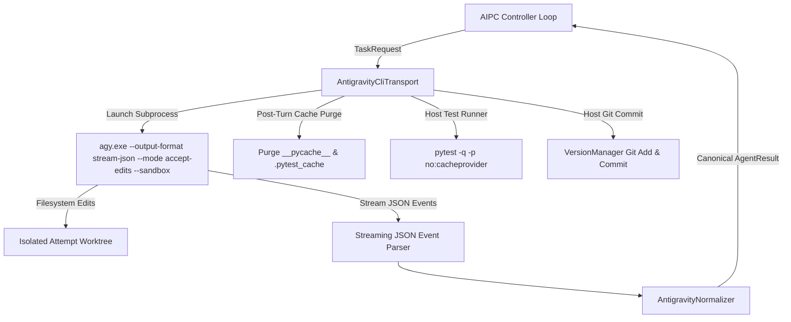

# Google Antigravity CLI (`agy`) Integration Guide

## 1. Executive Summary

This guide documents the headless integration of the official **Google Antigravity CLI** (`agy`) into the **AI Project Controller (AIPC)**. The Antigravity CLI adapter enables headless multi-agent coding, testing, and quota-fallback execution while adhering strictly to:
- **Provider-Neutrality Boundary** (`AGENTS.md` Rule 5): Core domain models (`AgentResult`, `TaskRequest`) and orchestration modules remain 100% provider-agnostic. All Google-specific behaviors are isolated within `aipc.adapters.gemini`.
- **Zero-Billing Subscription Reuse**: Operates by reusing the local developer's active Google Antigravity OAuth session (`~/.gemini/antigravity`), incurring zero Vertex AI billing and requiring no paid `GEMINI_API_KEY`.
- **Safe Host-Side Verification & Checkpointing**: Antigravity runs with `--mode accept-edits --sandbox`, while AIPC's `VersionManager` and `AntigravityCliTransport` manage workspace isolation, cache purging, verification test runs, and Git commit finalization.

---

## 2. Official Installation & Environment Setup

### 2.1 Installation
The Antigravity CLI binary is installed via the official PowerShell distribution script:
```powershell
iwr https://antigravity.google/cli/install.ps1 -useb | iex
```

### 2.2 Verified Host Environment
- **Binary Location**: `C:\Users\Administrator\AppData\Local\agy\bin\agy.exe` (symlinked or on user `PATH`)
- **CLI Version**: `1.5.2`
- **Host OS**: Microsoft Windows [Version 10.0.26100.x]
- **Python Runtime**: Python 3.13.0 (`.venv\Scripts\python.exe`)
- **Node & NPM**: Node v24.18.0, npm 11.18.0

### 2.3 Authentication & Zero API Key Requirement
The CLI automatically reads the cached personal OAuth session stored in:
- `C:\Users\Administrator\.gemini\antigravity\` (or user profile equivalent)

No API key (`GEMINI_API_KEY`) or Google Cloud project (`GOOGLE_CLOUD_PROJECT` / ADC) is required. This guarantees zero pay-as-you-go Vertex billing, running fully within the user's Google Antigravity desktop subscription.

### 2.4 Model Selection Policy
When invoking `agy`, model selection is configured via `GeminiAdapterConfig`:
- **Default Worker Model**: `gemini-3.8-flash-medium`
- **Rationale**: Flash models execute rapidly (~25–35 seconds per coding turn) and preserve the developer's high-tier quota (e.g., Argon) for architecture and controller-level tasks.

---

## 3. Architecture & Execution Flow



### 3.1 CLI Invocation Parameters
When a coding task is dispatched to an isolated Git worktree, `AntigravityCliTransport` launches `agy.exe` with the following flags:
```powershell
agy.exe -p "<prompt>" `
  --output-format stream-json `
  --mode accept-edits `
  --sandbox `
  --disable-slash-commands `
  --settings "<isolated-settings.json>" `
  --model gemini-3.8-flash-medium
```

- `--output-format stream-json`: Yields newline-delimited JSON objects for real-time progress and token telemetry.
- `--mode accept-edits`: Directs the agent to write code modifications directly to target files in the current worktree.
- `--sandbox`: Enforces workspace boundary restrictions.
- `--disable-slash-commands`: Prevents interactive prompt injection or macro expansion.
- `--settings`: Points to an ephemeral settings file that configures allow/deny lists and disables external integrations.

### 3.2 Ephemeral Cache Management & Host Finalization
Pytest and Python compile `.pyc` and `.pytest_cache` directories during verification runs. Under AIPC's strict `VersionManager` rules, untracked or ignored files trigger `DirtyWorkspaceError`. 

To prevent false dirty workspace rejections:
1. Pytest is invoked with `-p no:cacheprovider` and `sys.dont_write_bytecode = True` (`-B`).
2. `AntigravityCliTransport._post_turn_host_finalize` sweeps and purges any temporary `__pycache__` and `.pytest_cache` folders before invoking `git add -A`.
3. Host verification tests are executed. If tests pass, an attempt commit is created with an objective diff and test receipt.

---

## 4. Security Qualification Matrix

Under AIPC qualification rules (`Stage 4B`), provider capabilities are classified explicitly:

| Capability | Status | Implementation & Enforcement Notes |
|---|---|---|
| **`filesystem_write`** | **`AVAILABLE`** | Restricted strictly to the active `VersionManager` attempt worktree path. Writes outside the worktree are prohibited. |
| **`shell`** | **`BLOCKED`** | Agent subprocess is disallowed from spawning arbitrary host shell processes. Test commands and git commands are executed strictly by the AIPC host harness. |
| **`git`** | **`BLOCKED`** | The agent cannot run raw `git` commands. Branching, tags, and commits are owned exclusively by AIPC `VersionManager`. |
| **`network`** | **`BLOCKED`** | Outbound network calls from the workspace during execution are blocked. |
| **`approval_events`** | **`BLOCKED`** | Antigravity CLI does not expose an interactive pre-mutation JSON-RPC approval protocol. Failing-safe default applies. |
| **`streaming_events`**| **`AVAILABLE`** | Real-time token consumption, session ID, turn ID, and event logs are streamed via `stream-json`. |

**Overall Security Classification**: `QUALIFIED_FILESYSTEM_ONLY`.

---

## 5. Live Operational Verification Evidence

The integration of `agy.exe` has been verified across three concrete operational scenarios:

### 5.1 Section 8 — Real Coding Test via AIPC (`live-agy-coding`)
- **Objective**: Execute an automated coding phase using live `agy.exe` (`gemini-3.8-flash-medium`) to modify `index.html` and pass automated verification.
- **Outcome**: `PASS` (`gate_verdict: PASS`, `review_verdict: PASS`).
- **Duration**: 31.8s.
- **Tokens**: 45,424 input / 3,290 output.
- **Session / Turn**: `agy-77b32231-6d7f-475c-a8dc-7a086ddc3be0` / `f432d5bc-26a1-4acb-bf37-4ad9e2b1909a`.
- **Receipt**: `C:\Users\Administrator\.gemini\antigravity\brain\e43d966f-6ce5-49d3-8f48-ee311109e0cd\scratch\live_sec8_sec9\sec8_summary.json`.

### 5.2 Section 9 — Quota Fallback (`SIMULATED_CODEX_FAILURE_TO_LIVE_GEMINI`)
- **Objective**: Simulate `QUOTA_EXHAUSTED` on `codex-worker`, trigger AIPC `AgentRouter` fallback to `gemini-antigravity`, and complete phase execution.
- **Outcome**: `PASS` (`gate_verdict: PASS`, `review_verdict: PASS`).
- **Routing Sequence**: `codex-worker` (FAILED_NO_EFFECTS) -> `gemini-antigravity` (SELECTED -> STARTED -> COMPLETED).
- **Duration**: 40.8s.
- **Tokens**: 53,483 input / 3,758 output.
- **Session / Turn**: `agy-fa7d6303-45fe-4351-b1dc-fbcc549bbc41` / `fb18aabf-4ba5-44a3-a4cd-17b3a98a749b`.
- **Receipt**: `C:\Users\Administrator\.gemini\antigravity\brain\e43d966f-6ce5-49d3-8f48-ee311109e0cd\scratch\live_sec8_sec9\sec9_summary.json`.

### 5.3 Section 10 — Real Portfolio Project Live Enhancement (`Test_AI_CONTROLLER_me`)
- **Objective**: Dispatch live `agy.exe` to update the real personal portfolio website on branch `feature/antigravity-live-enhancement`.
- **Modifications**: Added `#aipc-live-badge` and back-to-top accessibility link in `index.html`; added `test_antigravity_live_enhancement` in `tests/test_website.py`.
- **Outcome**: `PASS` (`12/12` website tests passed).
- **Target Git SHA**: Attempt commit `01940359dd181e75b426462b93aa61d5157cef84` merged into `feature/antigravity-live-enhancement`.
- **Main Branch Protection**: `main` remained completely untouched at `5e65e6fe5f54397155b01a9611aa6e58597dba07`.
- **Receipt**: `C:\Users\Administrator\.gemini\antigravity\brain\e43d966f-6ce5-49d3-8f48-ee311109e0cd\scratch\live_sec8_sec9\sec10_summary.json`.
